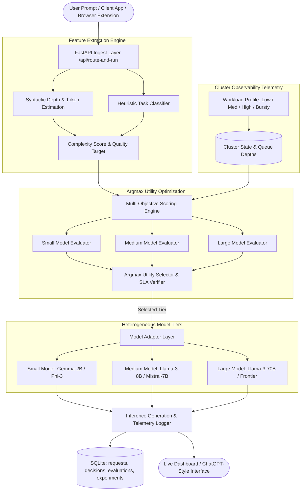

# Adaptive LLM Router

**“A Workload-Aware Adaptive Routing Framework for Cost-, Latency-, Quality-, and SLA-Optimized Enterprise LLM Inference”**

[](https://www.python.org/)
[](https://fastapi.tiangolo.com/)
[](https://react.dev/)
[](https://tailwindcss.com/)
[](backend/tests/)

> [!NOTE]
> **Academic Prototype Stage Disclosure**:  
> The application is currently an **early-stage research prototype undergoing initial testing**. Model performance and cluster infrastructure telemetry are simulated for experimental evaluation. It does not claim production readiness or conclusive empirical validation on frontier production clusters.

---

## 1. Project Description & Research Motivation

Most LLM applications force users or client applications to manually designate a specific model (e.g., GPT-4o, Claude 3.5 Sonnet, or Llama 3.3 70B) for every request. This static dispatch is inefficient:
- Simple summarization and data extraction queries are routinely routed to expensive 70B+ frontier models, inflating enterprise inference costs.
- Difficult multi-step reasoning problems fail or hallucinate when dispatched to smaller local models.
- Static routers that inspect query complexity alone (Query-Aware) remain completely blind to cluster congestion. When a preferred frontier model tier is under 90% GPU utilization with a deep request queue, routing high-priority requests to it triggers severe SLA latency violations.

The **Adaptive LLM Router** automates this routing decision by evaluating **both**:
1. **Query-Level Information**: Prompt length, estimated tokens, task category (Coding, Reasoning, Summarization, QA, Extraction), complexity score ($0.0 \le \mathcal{C} \le 1.0$), priority, quality demand, and custom SLA constraints (max latency, max cost).
2. **System & Infrastructure Telemetry**: Current cluster workload (Low, Medium, High, Bursty), queue length, predicted queuing latency, model availability status (Online / Offline), and normalized inference cost.

---

## 2. Architecture & Pipeline



---

## 3. Mathematical Utility Formulation

For every candidate model $m \in \mathcal{M} = \{\text{Small}, \text{Medium}, \text{Large}\}$, the routing engine calculates:

$$\text{Score}(m) = w_q \cdot Q(m) - w_c \cdot C_{\text{norm}}(m) - w_{\text{lat}} \cdot L_{\text{norm}}(m) - w_{\text{workload}} \cdot P_{\text{workload}}(m) - w_{\text{sla}} \cdot P_{\text{sla}}(m)$$

Subject to:
$$\sum w_i = 1.0 \quad \text{and} \quad \text{Online}(m) = \text{True}$$

### Selected Model:
$$m^* = \arg\max_{m \in \mathcal{M}_{\text{online}}} \text{Score}(m)$$

### Component Definitions:
- **$Q(m)$**: Predicted task-specific quality score in $[0.0, 1.0]$, calibrated against task category and query complexity.
- **$C_{\text{norm}}(m)$**: Normalized marginal inference cost bounded in $[0.0, 1.0]$.
- **$L_{\text{norm}}(m)$**: Normalized predicted turnaround latency (accounting for $M/M/1$ queue congestion factor).
- **$P_{\text{workload}}(m)$**: Workload contention penalty: $0.6 \cdot (\text{utilization}/100)^{1.8} + 0.4 \cdot (\text{queue}/20)$.
- **$P_{\text{sla}}(m)$**: Hard/soft SLA constraint breach penalty (triggered if predicted latency exceeds `max_latency_ms` or cost exceeds `max_cost`).

### Default Policy Weight Presets:
| SLA Preset | $w_q$ (Quality) | $w_c$ (Cost) | $w_{\text{lat}}$ (Latency) | $w_{\text{workload}}$ | $w_{\text{sla}}$ | Primary Use Case |
|---|---|---|---|---|---|---|
| **Balanced** (Default) | 0.40 | 0.20 | 0.15 | 0.10 | 0.15 | General enterprise production workloads |
| **Quality First** | 0.60 | 0.10 | 0.10 | 0.05 | 0.15 | Complex mathematical / legal / theorem proving |
| **Cost Saver** | 0.20 | 0.45 | 0.15 | 0.10 | 0.10 | Large batch extraction and summarization |
| **Low Latency** | 0.20 | 0.10 | 0.45 | 0.15 | 0.10 | Real-time chat & interactive agents |
| **SLA Critical** | 0.20 | 0.05 | 0.20 | 0.15 | 0.40 | Strict latency caps with zero-breach tolerance |

---

## 4. Full-Stack Application Interface (8 Views)

1. **Router**: ChatGPT-style prompt input, SLA presets, priority selector, custom latency/cost bounds, routing stepper animation (`Analyzing Request` $\to$ `Evaluating Models` $\to$ `Checking Workload` $\to$ `Selecting Model` $\to$ `Generating Response`), "Why this model?" deterministic explanation, candidate model comparison matrix, and visual decision trace.
2. **Live Monitor**: Real-time KPI cards (Requests Processed, Avg Latency, P95 Latency, Total Spend, SLA Compliance %, Router Overhead ms), requests over time area chart, model selection distribution donut, live cluster utilization progress bars, and SLA compliance gauges.
3. **Experiments**: Synthetic research benchmarking runner. Configure request count (50 / 100 / 300 / 500), workload (Low / Med / High / Bursty), and routing strategy. Includes one-click **"Run All 5 Baselines Comparison"** to generate side-by-side empirical evaluations.
4. **Analytics**: Cost vs Quality scatter plot across models and strategies, SLA violation rate by strategy bar chart, baseline comparison matrix, and task category breakdown.
5. **Models**: Model tier cards (Small, Medium, Large) showing latency, cost per 1k in/out, quality radar profiles, and an interactive **Online / Offline toggle** to demonstrate dynamic router resilience.
6. **Routing Policy**: Weight sliders for $w_q, w_c, w_{\text{lat}}, w_{\text{workload}}, w_{\text{sla}}$ with 100% normalization validation, preset buttons, and a **Live Sandbox Preview** that re-evaluates scores in real time as sliders move.
7. **Request Logs**: Searchable & filterable table of historical requests with filtering by model, workload, SLA status, and task type. Click any row to view the full prompt, output, and visual decision path graph.
8. **About Research**: University research context, academic problem formulation, mathematical utility equations, stage disclosure, and an interactive **Browser Extension Architecture Preview** modal.

---

## 5. Getting Started

### Prerequisites
- Python 3.10+ (Python 3.13 tested)
- Node.js 18+ (Node v20 tested) and npm

### Installation

1. **Clone repository & navigate to workspace**:
   ```bash
   cd llm_extension_app
   ```

2. **Backend Setup**:
   ```bash
   # Initialize virtual environment
   py -m venv .venv
   
   # Activate virtual environment (Windows PowerShell)
   .\.venv\Scripts\Activate.ps1
   # (Linux/macOS: source .venv/bin/activate)

   # Install dependencies
   pip install fastapi uvicorn pydantic pytest httpx
   ```

3. **Frontend Setup**:
   ```bash
   cd frontend
   npm install
   npm run build
   cd ..
   ```

### Running the Application

#### Option A: Unified Server (FastAPI serves both API and Web App)
```bash
# From workspace root
.\.venv\Scripts\python.exe -m uvicorn backend.main:app --host 127.0.0.1 --port 8000
```
Open **[http://127.0.0.1:8000](http://127.0.0.1:8000)** in your browser.

#### Option B: Development Mode (Hot-Reloading Frontend)
- Terminal 1 (Backend):
  ```bash
  .\.venv\Scripts\python.exe -m uvicorn backend.main:app --port 8000 --reload
  ```
- Terminal 2 (Frontend):
  ```bash
  cd frontend
  npm run dev
  ```
Open **[http://localhost:5173](http://localhost:5173)** in your browser.

---

## 6. Running Unit & Integration Tests

The project includes unit and integration tests verifying feature extraction, model toggling, SLA enforcement, workload-aware model switching, and benchmark aggregation:

```bash
.\.venv\Scripts\pytest.exe -v backend/tests/test_router.py
```

### Critical Research Hypothesis Test
The test suite validates the core research hypothesis:
- Under **Low Load**, an identical complex reasoning query routes to the **Large Model** because cluster resources are free.
- Under **High Load** (Large model utilization $> 85\%$ and queue $> 15$), the same query automatically routes to the **Medium Model** under a strict SLA target, preventing queue-induced latency failure!

---

## 7. REST API Endpoints

| Method | Endpoint | Description |
|---|---|---|
| `POST` | `/api/route-and-run` | End-to-end: extracts features, selects optimal model, runs inference, records telemetry |
| `POST` | `/api/route` | Returns candidate scores, winner, explanation, and decision trace without inference |
| `POST` | `/api/inference` | Executes direct model adapter inference on specified tier |
| `GET` | `/api/system-state` | Returns live cluster workload mode, queues, and aggregate throughput |
| `POST` | `/api/system-state/workload` | Updates cluster simulation workload (Low, Medium, High, Bursty) |
| `GET` | `/api/models` | Returns model tier specifications, current utilization, and online status |
| `POST` | `/api/models/toggle` | Toggles model tier online/offline status |
| `GET` | `/api/live-monitor` | Returns real-time KPI metrics, time-series data, and utilization gauges |
| `GET` | `/api/analytics` | Returns Pareto scatter data, SLA violation rate by strategy, and category counts |
| `GET` | `/api/policy` | Returns active routing weights and presets |
| `PUT` | `/api/policy` | Updates routing policy weights or switches active preset |
| `GET` | `/api/requests` | Returns searchable, filterable telemetry request logs |
| `GET` | `/api/requests/{id}` | Returns comprehensive trace and candidate evaluations for a specific request |
| `POST` | `/api/experiments` | Runs synthetic benchmark experiment for specified strategy and workload |
| `POST` | `/api/experiments/baselines` | Executes all 5 baseline strategies against identical workload batch |
| `GET` | `/api/experiments` | Lists stored experiment runs for comparative review |

---

## 8. Database Schema (SQLite)

The backend persists telemetry in `backend/router_telemetry.db`:
- `requests`: `id`, `timestamp`, `prompt`, `prompt_tokens`, `task_category`, `complexity`, `priority`, `sla_profile`, `max_latency_ms`, `max_cost`.
- `routing_decisions`: `request_id`, `selected_model`, `routing_strategy`, `router_score`, `router_overhead_ms`, `explanation`, `decision_trace_json`.
- `candidate_evaluations`: `request_id`, `model`, `predicted_quality`, `predicted_latency_s`, `estimated_cost`, `current_load_pct`, `queue_length`, `sla_status`, `router_score`, `quality_component`, `cost_penalty`, `latency_penalty`, `workload_penalty`, `sla_penalty`, `is_available`.
- `results`: `request_id`, `response_text`, `actual_latency_s`, `estimated_quality`, `sla_satisfied`, `tokens_generated`, `total_cost`.
- `experiments`: `id`, `timestamp`, `name`, `strategy`, `workload`, `request_count`, `mean_quality`, `total_cost`, `mean_latency_s`, `p50_latency_s`, `p95_latency_s`, `sla_violation_rate`, `throughput_rps`, `router_overhead_ms`, `details_json`.

---

## 9. Browser Extension Roadmap

The backend exposes stateless JSON endpoints with CORS headers enabled (`*`). In Phase 2, a Chromium Manifest V3 extension will:
1. Provide an omnibox shortcut and browser action popup.
2. Intercept prompts from enterprise web portals.
3. Call `POST /api/route-and-run` on the local router gateway daemon.
4. Surface the selected model tier and latency telemetry directly within the browser interface.
